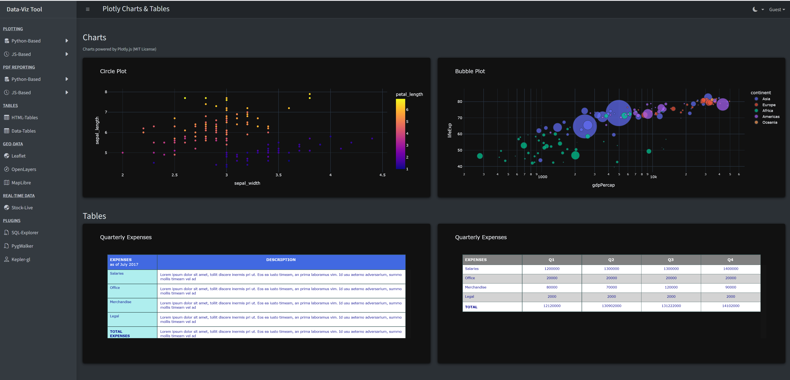
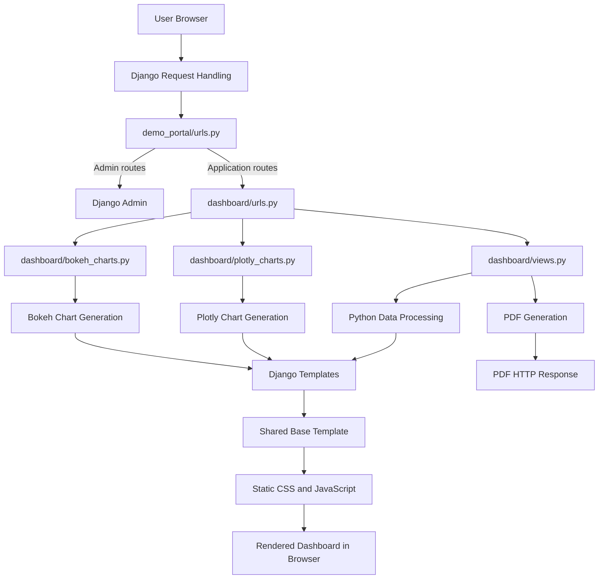

# Django Data Visualization Portal

A Django-based analytics and visualization application demonstrating how Python, data processing and modern JavaScript visualization libraries can be combined to build interactive dashboards and geospatial analysis tools.

The project brings together backend development, data integration, interactive visualization and reporting in a single web application.

## Screenshots

### Interactive Analytics Dashboard


### Geospatial Network Analysis


### Data exploration


## Key Features

### 1. Interactive Data Analytics
- Interactive charts and tables using Plotly and Bokeh.
- Exploratory data analysis using Pandas and PyGWalker.
- JavaScript-based charting examples.
- Sorting and filtering of analytical data.

### 2. Geospatial Visualization
- Interactive spatial visualizations using Kepler.gl and PyDeck.
- Map-based analysis using Leaflet and MapLibre.
- Spatial data processing using GeoPandas.
- Examples of working with large geospatial datasets.

### 3. Reporting and Export
- PDF report generation examples.
- Chart and data export workflows.
- Interactive analytical tables.

### 4. Backend Application
- Django-based application structure.
- Python data processing using Pandas and NumPy.
- Environment-based application configuration.
- Django URL routing, views and templates.

## Technology Stack

| Area | Technologies |
|---|---|
| Backend | Python, Django |
| Data Processing | Pandas, NumPy |
| Frontend | JavaScript, HTML5, CSS3, Bootstrap 5 |
| Visualization | Plotly, Bokeh, PyGWalker, Chart.js |
| Geospatial | GeoPandas, Kepler.gl, PyDeck, Leaflet, MapLibre |
| Reporting | WeasyPrint, Matplotlib, jsPDF |
| Database | SQLite (default development configuration) |

## Project Structure

```text
django-data-visualization-portal/
│
├── app_inputs/          # Application input files
├── dashboard/           # Django dashboard application
├── demo_portal/         # Django project configuration
├── screenshots/         # Application screenshots
├── static/              # CSS, JavaScript and static assets
├── templates/           # Django templates
│
├── manage.py
├── requirements.txt
└── README.md
```

## Application Architecture

The application follows Django's project-and-application structure. The `demo_portal` package contains the project configuration, while `dashboard` provides the main application functionality.

The application is organized around Django views, reusable templates, Python-based data processing and browser-side visualization libraries.

### Architecture Overview



### 1. Django Project Configuration

The `demo_portal` package provides the Django project-level configuration.

- `settings.py`: Configures installed applications, middleware, templates, static files, database settings and environment variables.
- `urls.py`: Defines the root URL configuration and connects the dashboard application.
- `wsgi.py`: Provides the WSGI application entry point.
- `manage.py`: Provides Django management commands for development and maintenance.

The root URL configuration handles Django Admin requests and forwards application requests to `dashboard.urls`.

### 2. Dashboard Application and URL Routing

The `dashboard` application contains the main request handlers and visualization functionality.

Its URL configuration maps incoming requests to the appropriate view or visualization module.

Key modules:

| Module | Responsibility |
|---|---|
| `urls.py` | Maps application URLs to views |
| `views.py` | Handles dashboard pages, data preparation, geospatial demonstrations and PDF responses |
| `plotly_charts.py` | Creates Plotly charts and interactive tables |
| `bokeh_charts.py` | Creates Bokeh visualizations and data tables |
| `models.py` | Reserved for Django data models |
| `tests.py` | Reserved for application tests |

The application uses function-based Django views to prepare page context and return HTML or generated PDF responses.

### 3. Data Processing and Visualization

Python handles data preparation and server-side visualization generation.

The application integrates several technologies:

- **Pandas and NumPy:** Data manipulation, sample data generation and numerical processing.
- **GeoPandas and Shapely:** Geospatial data processing and geometry operations.
- **Plotly:** Interactive charts and analytical tables.
- **Bokeh:** Interactive charts and tabular visualizations.
- **PyGWalker:** Interactive data exploration.
- **Kepler.gl:** Geospatial visualization.
- **Matplotlib:** Static charts and multi-page PDF reports.
- **WeasyPrint:** PDF generation from HTML content.

The current demonstration pages use generated data and sample datasets to illustrate the integration of these libraries with Django.

### 4. Presentation Layer

The presentation layer uses Django templates, HTML, CSS and JavaScript.

The template structure separates the shared application layout from individual dashboard pages:

- `templates/base/base.html`: Shared page layout, navigation, sidebar, theme controls and frontend library references.
- `templates/dashboard/`: Individual pages for charts, maps, tables and reporting demonstrations.

Individual pages extend the shared base template and receive their data through Django template context.

The frontend uses Bootstrap and AdminLTE for layout and navigation, with JavaScript visualization libraries providing interactive browser-side functionality.

Static assets such as CSS, JavaScript and frontend libraries are maintained under the `static/` directory. Some third-party JavaScript libraries are loaded from external CDNs.

### 5. Reporting and Export

The application demonstrates both Python-based and browser-oriented reporting workflows.

- Matplotlib generates multi-page PDF reports using in-memory PDF buffers.
- WeasyPrint converts HTML-based report content into downloadable PDF documents.
- Plotly charts can be rendered as HTML or exported as images for report generation.
- jsPDF demonstrates browser-side PDF generation.

Generated PDF documents are returned through Django HTTP responses.

### 6. Database and Data Persistence

SQLite is configured as the default development database through Django settings.

The current demonstration workflows primarily use generated data and library-provided sample datasets. Application-specific Django models and persistent business-data workflows have not yet been implemented.

This keeps the current project focused on demonstrating Django integration with analytics, visualization, geospatial and reporting libraries.

### 7. Request and Response Lifecycle

A typical dashboard request follows this sequence:

1. A user opens a dashboard URL in the browser.
2. Django receives the HTTP request and evaluates the root URL configuration.
3. The request is forwarded to the dashboard application's URL dispatcher.
4. The appropriate view or visualization module executes.
5. Python prepares the required data and visualization output.
6. Django renders the relevant template using the supplied context.
7. The browser loads the rendered page and executes the required frontend JavaScript.
8. The completed dashboard is presented to the user.

For PDF requests, the view generates the document and returns it as an HTTP file response.

### 8. Potential Future Improvements

As the application evolves, the architecture can be extended with:

- Dedicated service modules for data processing and report generation.
- Separate data-access components for database and external data sources.
- Django models where persistent application data is required.
- Unit and integration tests for views, data processing and report generation.
- Environment-specific configuration and reproducible dependency management.
- Automated validation through GitHub Actions.


## Getting Started

### Prerequisites
- Python 3.12 (tested configuration)
- Git

### 1. Clone the repository

```bash
git clone https://github.com/kmaddala85/django-data-visualization-portal.git
cd django-data-visualization-portal
```

### 2. Create a virtual environment

```bash
python -m venv .venv
```

Windows PowerShell:

```powershell
.\.venv\Scripts\Activate.ps1
```

Linux / macOS:

```bash
source .venv/bin/activate
```

### 3. Install dependencies

```bash
pip install -r requirements.txt
```

### 4. Configure environment variables

Create a `.env` file in the project root using `.env.example` as a template.

Do not commit your actual `.env` file.

### 5. Apply migrations

```bash
python manage.py migrate
```

### 6. Start the development server

```bash
python manage.py runserver
```

Open:

http://127.0.0.1:8000/

## Configuration and Data

The repository uses SQLite as its default development database.

Use synthetic or sanitized sample datasets when demonstrating the application. Do not commit company data, customer information, network configurations or credentials.

## Project Scope

This repository is a portfolio and demonstration project showcasing Django development, data analytics and visualization techniques.

It is not presented as a production deployment.

## License

MIT License.
